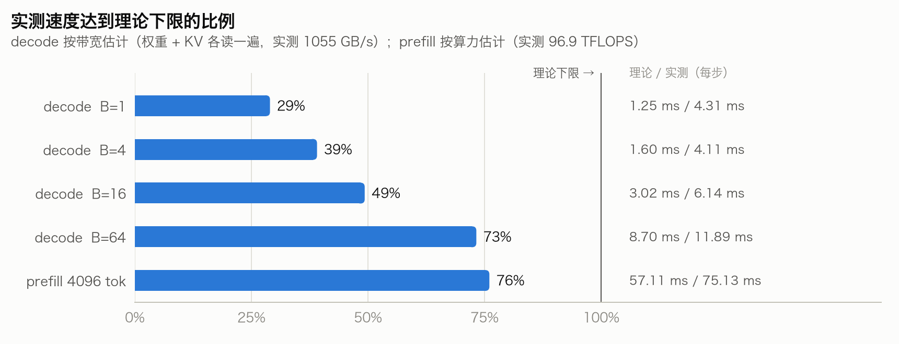
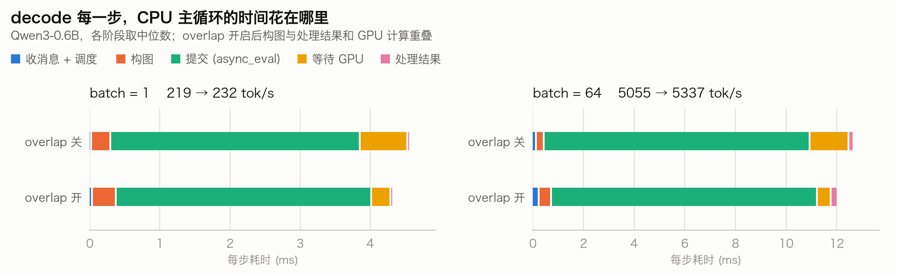
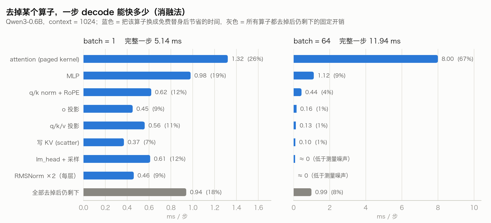
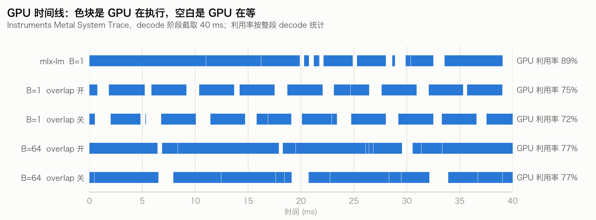
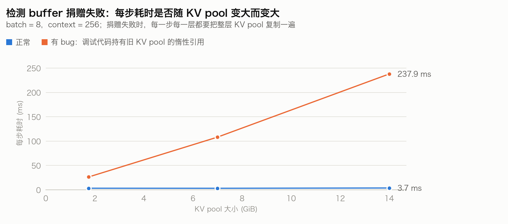

# 第 10 章：性能分析 —— 这次推理为什么慢？

> 代码：`python/minisgl_mlx/profiling.py`
> 实验：`python tutorials/ch10_profiling.py <子命令>`（加 `--plot docs/images` 出图；`all` 一次跑完 ①~⑥）
> 本章所有图和数字都来自 Apple M5 Ultra + Qwen3-0.6B bf16 的同一轮测量（`all --with-mlx-lm`）。

"慢"本身不是一个可以直接优化的问题。分析的过程，就是把它拆成一串可以测量、可以证伪的小问题：

| # | 问题 | 工具 | 子命令 |
|---|---|---|---|
| ① | 离硬件的理论极限还有多远？慢在访存、算力，还是额外开销？ | roofline 估算 | `roofline` |
| ② | CPU 主循环的每个阶段各花多少时间？ | `PhaseTimer` | `phases` |
| ③ | 一步 decode 的 GPU 时间花在哪个算子上？ | 消融实验 | `ops` |
| ④ | 有没有不该发生的 buffer 拷贝？ | 改变 KV pool 大小做对照 | `donation` |
| ⑤ | MLX 的缓存、系统 swap 正常吗？ | `memory_snapshot` | `memory` |
| ⑥ | GPU 有没有在空等？ | Instruments GPU 时间线 | `timeline` |
| ⑦ | 某个 kernel 内部发生了什么？ | Xcode GPU 帧捕获 | `capture` |

还有一个"第 0 步"：先看调度器自己的日志。`running / pending / kv_usage / prefix hit` 能告诉你请求是不是在**排队**，
而不是在计算 —— 如果 `pending > 0` 且 `kv_usage` 很高，那是 KV 容量不够（第 6.2 节的准入控制），加 `--num-tokens` 比优化 kernel 有用得多。

---

## 10.1 理论下限：先算出"最快能有多快"

decode 每一步至少要把**全部权重**和**本 batch 所有请求的 KV** 从内存读一遍，所以

```
decode 一步的下限 = (权重字节数 + batch × context × 每 token 的 KV 字节数) / 内存带宽
prefill 的下限    = (2 × 参数量 × token 数 + attention 的 FLOPs) / 矩阵乘算力
```

带宽和算力都要**在本机实测**（`measure_bandwidth` / `measure_matmul_tflops`），而且有个坑：

> 第一次写这个工具时，预热只跑了 3 轮、取平均值，测出来的带宽只有 499 GB/s，结果算出 B=64 时
> "达到理论下限的 155%"—— 这显然不可能。GPU 需要预热几轮才会升到最高频率，单次测量的波动也很大
> （同一台机器 500~1050 GB/s）。改成预热 10 轮、取 20 次中最好的一次后，稳定在约 1055 GB/s。
> **理论下限要用"可达峰值"，否则会得出荒谬的结论。**

<picture>
  <source media="(prefers-color-scheme: dark)" srcset="images/ch10-roofline-dark.png">
  
</picture>

| 场景 | 理论下限 | 实测（每步） | 达到下限 |
|---|---|---|---|
| decode B=1 | 1.25 ms | 4.31 ms | 29% |
| decode B=4 | 1.60 ms | 4.11 ms | 39% |
| decode B=16 | 3.02 ms | 6.14 ms | 49% |
| decode B=64 | 8.70 ms | 11.89 ms | 73% |
| prefill 4096 tok | 57.11 ms | 75.13 ms | 76% |

怎么读：

- **比例低（B=1 只有 29%）**：硬件远没吃满，时间花在了"额外开销"上 —— 提交、同步、kernel 启动、调度。
  优化方向是减少每步的固定开销，而不是减少数据量。
- **比例高（B=64、prefill 在 75% 左右）**：已经接近硬件上限，再抠 kernel 收益有限。
  想更快只能**减少要读的字节数**（KV / 权重量化）或计算量。
- B=64 时 8.70 ms 的下限里，KV 占了 7.5 GiB、权重只占 1.1 GiB —— batch 大了以后，decode 的瓶颈从"读权重"变成了"读 KV"。

---

## 10.2 CPU 侧：主循环的每个阶段花了多少时间

`PhaseTimer`（`profiling.py`）不改调度器的任何代码，只是把实例上的几个方法替换成"计时 + 调用原方法"的包装：

```python
from minisgl_mlx.profiling import PhaseTimer
timer = PhaseTimer().attach(llm)        # llm 是 LLM 或 Scheduler 实例
llm.generate(...)
print(timer.summary())
```

为了能单独计时"提交"和"等待"，调度器把 `mx.async_eval` / `mx.eval` 包成了两个小方法 `_submit` / `_wait`。
离线 benchmark 也可以直接打开：`python benchmark/offline.py --profile`。

<picture>
  <source media="(prefers-color-scheme: dark)" srcset="images/ch10-phases-dark.png">
  
</picture>

| | 收消息+调度 | 构图 | 提交 (async_eval) | 等待 GPU | 处理结果 | 每步 | 吞吐 |
|---|---|---|---|---|---|---|---|
| B=1 overlap 关 | 0.03 | 0.28 | 3.56 | 0.68 | 0.01 | 4.57 ms | 219 tok/s |
| B=1 overlap 开 | 0.04 | 0.34 | 3.64 | 0.27 | 0.01 | 4.31 ms | 232 tok/s |
| B=64 overlap 关 | 0.16 | 0.31 | 10.50 | 1.54 | 0.12 | 12.66 ms | 5055 tok/s |
| B=64 overlap 开 | 0.26 | 0.49 | 10.50 | 0.54 | 0.20 | 11.99 ms | 5337 tok/s |

最大的发现在"提交"这一列：**`mx.async_eval` 并不是立即返回的**，它阻塞的时间几乎等于整步的 GPU 时间。
MLX 在编码计算图时会限制同时在途的工作量，编码到一定程度就要等前面的 command buffer 完成。
于是 overlap 能"藏"进 GPU 计算里的，只剩下处理结果和下一步的调度、构图 —— 这一轮测量中每步只省下 0.3~0.7 ms。
这也解释了为什么 MLX 上 overlap 的收益（这一轮约 6%，第 7.6 节在不同负载下测到 8~26%）比 CUDA 上小。

---

## 10.3 GPU 侧：一步 decode 的时间花在哪个算子上

### 第一次尝试：单独测每个算子 —— 失败

最直观的做法是把每个算子单独拿出来，在 decode 的形状下计时，再加起来。结果算子之和（B=1 时 6.76 ms）
**比真实的一步（4.34 ms）还多**（这是早先一轮测量的数字）。原因是单独测量时，几百个小 kernel 各自带着提交和调度的开销；
而在真实的一步里它们是连续编码执行的，开销被摊薄了。单独测得的数字不能相加，用来指导优化还会误导人。

### 消融法：在真实的一步里，把某个算子换成"免费"的替身

手工拼一个 decode batch，反复执行完整的一步（模型 forward + 采样），测出基准时间；然后每次把一类算子
（如所有层的 MLP）换成"直接返回常量"的替身，看一步快了多少。这个差值回答的正是优化时最关心的问题：
**把这个算子优化到极致，最多能赚多少？**

### 陷阱：惰性求值把整段计算当成了死代码

第一版消融的结果很离谱："去掉 lm_head 能省 92%""去掉 o 投影能省 77%"。原因是第 1 章讲过的惰性求值：
把 lm_head 换成常量以后，输出不再依赖任何一层，**整个 transformer 都不会被执行**；
o 投影换成常量，attention 的输出没人用了，attention 也会被跳过。

修复：替身必须保留对输入的依赖。MLX 正好有一个只加依赖、不做计算的原语 `mx.depends`：

```python
def free(const):                       # 返回常量，但依赖输入 x —— 上游照常计算
    return lambda x, *rest: mx.depends(const, x)
```

KV 写入、attention 这类"副作用"也一样：不写 KV 的替身仍然要让 pool 依赖 k / v，
不算 attention 的替身仍然要依赖 KV pool（见 `cmd_ops` 里的 `fake_store` / `fake_attention`）。

> 这个陷阱值得记住：**在惰性求值的框架里做性能实验，一定要确认你以为在跑的计算真的在跑。**

<picture>
  <source media="(prefers-color-scheme: dark)" srcset="images/ch10-ops-dark.png">
  
</picture>

| 去掉的算子 | B=1 节省 | B=64 节省 |
|---|---|---|
| attention (paged kernel) | 1.32 ms (26%) | 8.00 ms (67%) |
| MLP | 0.98 ms (19%) | 1.12 ms (9%) |
| q/k norm + RoPE | 0.62 ms (12%) | 0.44 ms (4%) |
| o 投影 | 0.45 ms (9%) | 0.16 ms (1%) |
| q/k/v 投影 | 0.56 ms (11%) | 0.13 ms (1%) |
| 写 KV (scatter) | 0.37 ms (7%) | 0.10 ms (1%) |
| lm_head + 采样 | 0.61 ms (12%) | ≈ 0 |
| RMSNorm ×2（每层） | 0.46 ms (9%) | ≈ 0 |
| **全部去掉后仍剩下** | **0.94 ms (18%)** | **0.99 ms (8%)** |
| 完整一步 | 5.14 ms | 11.94 ms |

怎么读：

- **B=64：attention 一项占 67%**。它每步要读约 7.5 GB 的 KV，8 ms 意味着有效带宽约 940 GB/s，已经接近峰值。
  这和 10.1 的结论一致：大 batch 时瓶颈是读 KV，下一步应该做 KV 量化（练习 10），而不是继续调 kernel。
- **B=1：开销分散在各处，且"全部去掉后仍剩下"约 1 ms（18%）**。这部分是构图、提交、同步等固定开销，
  不管算子多快都省不掉。B=1 时，MLP（读 528 MB 权重）节省 0.97 ms，有效带宽只有约 540 GB/s：
  单个 token 的矩阵-向量乘吃不满带宽。
- 各项节省之和不一定等于总时间，因为算子之间会互相掩盖等待。B=1 时每一项只有零点几毫秒，
  两次运行之间单项可以差到 ±0.3 ms（例如 attention 在另一轮测量中是 0.73 ms），要多跑几次看趋势，不要只看一次的排名。

---

## 10.4 GPU 时间线：GPU 有没有在空等

前面的工具都是在 CPU 侧"猜" GPU 在做什么。要直接看 GPU，得用 Instruments 的 **Metal System Trace**，
它记录了每个 command buffer 在 GPU 上的起止时间。`timeline` 子命令把整个流程自动化了：

```bash
# 1. 录制（--launch 启动一个新进程，并记录它的 GPU 活动）
xctrace record --template 'Metal System Trace' --output run.trace --launch -- python workload.py
# 2. 导出 GPU 执行区间表
xctrace export --input run.trace --xpath '/trace-toc/run[@number="1"]/data/table[@schema="metal-gpu-intervals"]'
```

导出的 XML 有一个细节：重复的值会写成 `<xxx ref="12"/>`，引用前面 `id="12"` 的元素，所以解析时要维护一张 id 表
（`profiling.export_gpu_intervals`）。拿到我们进程在 Compute 通道上的区间后，合并重叠的区间，就得到了 GPU 真实的忙碌时间、
利用率和空隙分布（`gpu_timeline_stats`）。为了把模型加载、预热排除在外，workload 在正式测量前 `sleep(0.5)`，
分析时只取最后一个 > 300 ms 空闲之后的部分。

<picture>
  <source media="(prefers-color-scheme: dark)" srcset="images/ch10-timeline-dark.png">
  
</picture>

蓝色是 GPU 在执行，空白是 GPU 在等（色块中间的细缝是 command buffer 的边界，几乎没有间隔）。

| | 每步 | GPU 忙碌 | GPU 空闲 | 利用率 |
|---|---|---|---|---|
| mlx-lm B=1 | 3.27 ms | 2.91 ms | 0.36 ms | 89% |
| 本项目 B=1 overlap 开 | 4.45 ms | 3.33 ms | 1.12 ms | 75% |
| 本项目 B=1 overlap 关 | 4.63 ms | 3.34 ms | 1.30 ms | 72% |
| 本项目 B=64 overlap 开 | 15.63 ms | 12.07 ms | 3.56 ms | 77% |
| 本项目 B=64 overlap 关 | 15.60 ms | 11.97 ms | 3.63 ms | 77% |

注意两点：

- Instruments 录制本身有开销，这里的每步耗时比不录制时长（B=64 约 15.6 ms，不录制时约 12 ms）。
- **GPU 忙碌时间很稳定，空闲时间波动很大。** 同样的配置录了三次：mlx-lm 的利用率在 85%~93% 之间，
  本项目 B=1 overlap 开在 75%~80%，overlap 关在 62%~72%；B=64 这一次开不开 overlap 都是 77%，另外两次是 82%~83% 对 73%~77%。
  所以判断 overlap 的效果要多录几次，不能只看一次。

### 案例：单请求为什么比 mlx-lm 慢？

第 7 章一开始的猜测是"写法 B 每步留下了空隙"。时间线给出了更准确的答案 —— 差距由两部分组成（三次录制的范围）：

1. **GPU 计算本身多 0.4~0.5 ms**（这一次是忙碌 3.33 对 2.91 ms；mlx-lm 的分析窗口里还包含一次完整的 prefill，
   纯 decode 的差距还要更大一点）。B=1 时我们的自定义 kernel 只有 8 个 threadgroup，
   scatter 写 KV、逐 token RoPE 等也都比 mlx-lm 的连续 cache 多一些开销。
2. **步与步之间 GPU 空闲多 0.4~0.8 ms**（这一次是 1.12 对 0.36 ms）。mlx-lm 在上一步算完之前就把下一步提交上去，
   GPU 几乎不停；我们的 overlap 能减少空闲，但没有消除。

而"换成写法 A 就好了"这个猜测，被 10.5 节的实验否定了。

---

## 10.5 内存：缓存、swap 与 buffer 捐赠

### memory：MLX 的缓存和系统 swap

```
attn=naive, mlx_cache_limit=4.0 GiB
  active     9.07 GiB ->    9.07 GiB
  peak       0.00 GiB ->   10.86 GiB
  cache      0.00 GiB ->    4.00 GiB
  swap      10.08 GiB ->   10.08 GiB
  ! 缓存已到上限：有大量尺寸各异的临时 buffer 无法复用（考虑把形状分桶）
  ! 峰值增量超过一层 KV pool：可能发生了 buffer 拷贝，或存在很大的临时数组
```

这里用的是 naive attention 后端，两条警告都在预期之中：它每步都要 gather 出很大的临时数组（第 4.3 节），
所以缓存很快涨到上限，峰值也明显高于常驻内存。swap 没有增长，说明缓存上限起了作用。

第 4.5 节那次"naive 后端只有 268 tok/s"就是这样查出来的：当时没有缓存上限，`cache` 涨到了 65 GiB，`swap` 也在涨。
在统一内存的 Mac 上，**MLX 的缓存就是系统内存**；swap 一旦增长，性能会断崖式下降。

### donation：怎样发现"不该发生的拷贝"

buffer 捐赠失败不会报错，只会让程序变慢。它有两个可测量的特征：

- **每步耗时随 KV pool 的容量线性增长**（正常情况下，每步耗时只和 batch、context 有关，和 pool 有多大无关）；
- **峰值内存比常驻内存多出至少一层 pool**（拷贝时新旧两份同时存在）。

`donation` 子命令用三种 pool 大小做对照，并放了一个"阳性对照"：一个很容易写出来的 bug ——
为了调试，在写 KV 之前记下每层 pool 的第一行（`kv.k[i][0:1]`）。这只是一个没被求值的切片，
但它在计算图里引用着写入前的旧 pool，于是每一层的 scatter 都无法捐赠：

<picture>
  <source media="(prefers-color-scheme: dark)" srcset="images/ch10-donation-dark.png">
  
</picture>

| KV pool | 正常：每步 | 正常：峰值增量 | 有 bug：每步 | 有 bug：峰值增量 |
|---|---|---|---|---|
| 1.75 GiB | 3.25 ms | 1.0 GiB | 26.4 ms | 3.6 GiB |
| 7.00 GiB | 3.16 ms | 1.0 GiB | 108.2 ms | 14.0 GiB |
| 14.00 GiB | 3.74 ms | 1.0 GiB | 237.9 ms | 28.0 GiB |

（正常情况下固定多出的约 1 GiB 是 prefill 的临时数组，不随 pool 增长。）

两个信号里，**峰值内存比耗时稳定得多**：同样是 1.75 GiB 的 pool，带 bug 的版本在另一次运行中每步是 7.3 ms（这一轮是 26.4 ms），
但两次的峰值增量都是 3644 MiB，一个字节都不差。耗时受分配器、系统状态影响很大；"多出来的内存"却是拷贝的直接证据。

同样的方法（`donation --pattern-a`）也检验了第 7 章的"写法 A"：在真实引擎里，写法 A 的峰值内存与写法 B 完全相同，
**没有发生拷贝**；吞吐则互有胜负，差距在测量波动范围内（B=1、14 GiB pool 时 A 慢约 25%；B=8、1.75 GiB pool 时 A 快约 8%）。
第 7 章据此做了更正。

---

## 10.6 看单个 kernel：Xcode GPU 帧捕获

时间线只能看到 command buffer 粒度。想看每个 kernel 的耗时、占用率、读写带宽，用 Metal 的帧捕获：

```bash
python tutorials/ch10_profiling.py capture --batch 4 --context 256 --capture-steps 2
open decode.gputrace          # 在 Xcode 里打开，Performance / Timeline 中可以看到每个 kernel
```

- 捕获必须在进程**启动时**就设置 `MTL_CAPTURE_ENABLED=1`（脚本会自动以这个环境变量重新执行自己），
  否则 `mx.metal.start_capture` 会报 "Capture layer is not inserted"。
- 捕获会把用到的所有 buffer 都存下来：2 步 decode 就有约 2.4 GB。务必用小模型、小 KV pool、很少的步数。

---

## 10.7 复盘：这一轮分析推翻了哪些结论

| 原来的结论 | 怎么被推翻的 | 现在的结论 |
|---|---|---|
| "写法 A 会让 KV pool 每步被整个拷贝" | 真实引擎里两种写法的峰值内存相同 | 只在合成的最坏情况下成立；真实引擎里每层 pool 的读写自然错开 |
| "B=1 慢是因为写法 B 的提交空隙" | 换成写法 A 并不稳定地更快；GPU 时间线显示忙碌时间也更长 | GPU 计算多 0.4~0.5 ms + 空等多 0.4~0.8 ms |
| 带宽 499 GB/s，B=64 达到下限的 155% | 结果不可能超过 100% | 预热不足；要取多次测量的最好值 |
| 单独测各算子，再加起来 | 算子之和大于真实的一步 | 改用消融法 |
| 消融：去掉 lm_head 省 92% | 不合常理 | 惰性求值跳过了上游；替身要用 `mx.depends` 保留依赖 |

几条通用的经验：

1. **先算理论下限。** 它告诉你该往哪个方向努力，也能帮你识别荒谬的测量结果。
2. **每个测量结果都要过一遍"是否合理"。** 超过 100% 的效率、比整体还大的部分之和，都说明测量方法本身有问题。
3. **控制变量，并且准备阳性对照。** 检测工具在"已知有问题"的情况下必须能报警，否则它说"没问题"也不可信。
4. **在惰性求值的框架里，确认被测的计算真的执行了。**
5. **CPU 侧的计时只能间接推断 GPU，最终要用 GPU 时间线确认。**

## 10.8 速查表：症状 → 怎么查 → 怎么改

| 症状 | 先用什么查 | 常见原因 | 怎么改 |
|---|---|---|---|
| TTFT 高，日志里 `pending > 0`、`kv_usage` 高 | 调度器日志 | KV 容量不够，请求在排队 | 加 `--num-tokens`；降低默认 `max_tokens` |
| 小 batch 远低于理论下限 | `roofline` + `timeline` | 固定开销、GPU 空等 | overlap；减少每步算子数；`mx.compile` |
| 大 batch 接近理论下限 | `roofline` + `ops` | 读 KV / 权重的带宽 | KV / 权重量化 |
| 每步耗时随 KV pool 容量增长 | `donation`、峰值内存 | buffer 捐赠失败（有地方引用着旧 pool） | 找到并去掉那个引用 |
| 越跑越慢、波动大 | `memory`（`cache`、`swap`） | MLX 缓存膨胀，挤进 swap | `mx.set_cache_limit`；把形状分桶 |
| 第一个请求特别慢 | 对比第二次运行 | kernel 首次编译 | 启动时预热 |
| 循环里莫名卡顿 | `phases` | 热路径里有 `.item()` / `.tolist()` / `print(array)`，触发了同步 | 只在处理结果时读回一次 |
| 某个 kernel 可疑 | `capture` + Xcode | 并行度不够、访存不连续 | 改 kernel（如 split-K） |
